# Zen Tab Search Anytime and Anywhere

Find any tab, switch spaces, add context, and stay focused in Zen Browser.

Zen Tab Search is a fast fuzzy search overlay for tabs, spaces, and custom labels. It is exclusive to [Zen Browser](https://zen-browser.app/).

## Contents

- [Installation](#installation)
  - [From a GitHub release (recommended)](#from-a-github-release-recommended)
  - [Build from source](#build-from-source)
- [Features](#features)
  - [Settings](#settings)
  - [Omnibar](#omnibar)
  - [Folders](#folders)
  - [Toolbar popup (removed)](#toolbar-popup-removed)
  - [Status, rename, and the tab menu](#status-rename-and-the-tab-menu)
  - [Pinned URLs](#pinned-urls)
  - [Timers](#timers)
  - [Host overrides](#host-overrides)
  - [Layout and theme](#layout-and-theme)
  - [Sound](#sound)
  - [Reuse an open tab for external links](#reuse-an-open-tab-for-external-links)
  - [AI agents (MCP)](#ai-agents-mcp)
- [Important notices](#important-notices)
- [Credits and license](#credits-and-license)
  - [Special thanks](#special-thanks)
- [Why this cannot be published on AMO](#why-this-cannot-be-published-on-amo)
- [Creating a release](#creating-a-release)
- [Development](#development)
- [Project structure](#project-structure)
- [License](#license)

## Installation

### From a GitHub release (recommended)

1. Download the latest `.zip` from the [Releases page](https://github.com/SanderCokart/Zen-Tab-Search-Anytime-and-Anywhere/releases).
2. Open `about:config` in Zen Browser.
3. Set these preferences and restart Zen:
  - `extensions.experiments.enabled` = `true`
  - `xpinstall.signatures.required` = `false`
4. Open `about:addons`, click the gear icon, and choose **Install Add-on From File…**.
5. Select the downloaded `.zip` (you can also drag it onto the page).

**Updating.** The extension checks GitHub for a newer release every few hours. When there is one, the status bar along the bottom of the omnibar shows *There is a new version available!*. Click it to install the update in place (your settings are kept) or to download the zip and install it the same way as above. Otherwise the status bar shows your version and a **Check for updates** button that asks GitHub straight away.

**Status bar.** Under the search, the omnibar counts your tabs, essential tabs and spaces, plus the GitHub and GitLab issue tabs, todos and running timers once there are any.

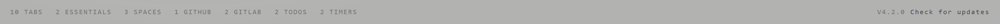

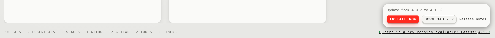

**Optional: let AI agents control Zen.** The same release has a `zen-tab-search-mcp.mjs` asset, the MCP server for Claude, Cursor and other MCP clients. It needs Node.js 20 or newer. See [mcp/README.md](mcp/README.md#install) to download it, turn it on in the settings, and register it with your client.

### Build from source

```bash
npm install
npm run zip
```

The zip is produced by WXT, with a sources archive beside it. `npm run zip:no-sources` writes only the Firefox zip, with debug off. Install it using the same `about:addons` → gear → **Install Add-on From File…** flow above.

## Features

Change or assign shortcuts in `about:addons` → **Zen Tab Search** → **Manage Extension Shortcuts** (`Ctrl+Shift+A` opens `about:addons`).

### Settings

Every option in this guide lives in **Display options**. Open it from the ⚙ gear at the right of the search field on the omnibar. It also sits in `about:addons` → **Zen Tab Search** → **Preferences**. Changes apply as you make them, with no save button.

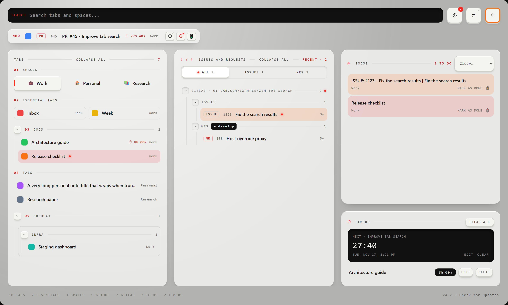

<details>
<summary>The full Display options page</summary>

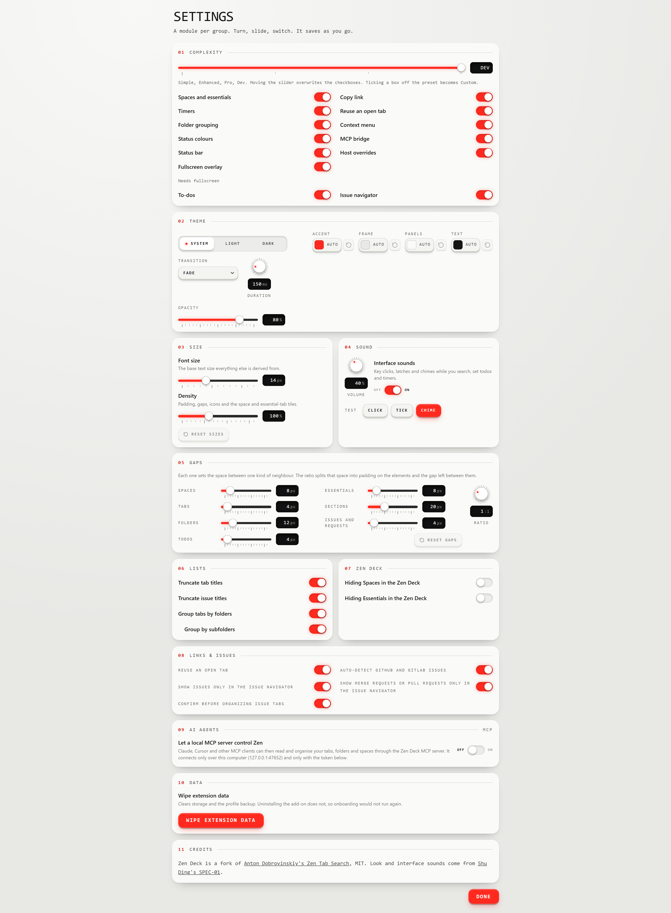

</details>

### Omnibar

`Alt+F` opens the omnibar over the whole browser window, in the browser chrome. Here is what you get:

- **Search** titles, URLs, and custom labels across every Zen space.
- **Spaces and essential tabs** sit in grids above the list. Zen folders become their own sections.
- **NOW strip** under the search field shows the tab you are on, with its status, timer, and todo controls. Click the strip to close the search: that tab is already on screen. The keys on the strip keep the search open.
- **Tab keys** for close, rename, todo, timer, and host sit on the right of each row. They appear when you point at the row, and the timer and host readout steps aside for them.
- **Issues** from GitHub and GitLab open in a navigator beside the tabs, grouped by project, with each request's target branch shown.
- **Todos** sit in a third column as tinted blocks, each with a **Mark as done** button and a **Clear…** dropdown for the whole column.
- **Keyboard:** `Up` and `Down` move one result, `Left` and `Right` jump several, `Enter` activates, `Escape` closes, and `Tab` moves between the tab list and the issue navigator.
- **Prefixes:** `#` lists issues, `!` lists merge and pull requests, and `@` jumps to todos.

> **Note:** the browser chrome is the browser's own interface around the page, such as the toolbars, sidebar and tab strip. It is not Google Chrome. Zen is built on Firefox, so this is the Firefox-style chrome you already know.

<details>
<summary>Why the omnibar lives in the browser chrome</summary>

The omnibar is hosted by the browser window rather than drawn on top of the page. Search therefore works on any page, including pages that have no content the extension can draw over, such as Zen's built-in pages.

</details>

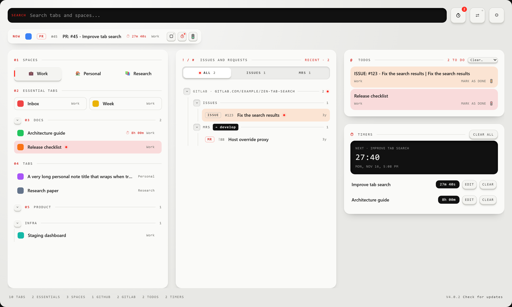

Type to filter. **Show issues only in the Issue Navigator** and **Show merge requests or pull requests only in the Issue Navigator** keep those tabs in the middle column and drop them out of the tab list, independently.

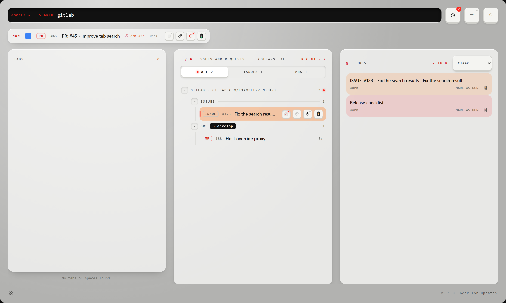

### Folders

Click a folder's header to fold it, and the folder eases open or shut again. Folders can be nested, and each subfolder folds on its own.

The Tabs and Issues and requests headers each have a **Collapse all** button in the middle of the rule. It turns into **Expand all** once every group in that column is folded, so one click folds or opens the whole column.

A folded folder still shows its current tab, in the folder where that tab lives, so you always see where you are. Its other tabs stay hidden until you open the folder again. While you type a query, every match shows, even inside folded folders.

In a tab's context menu, **Move to folder** lists every folder as `Space · Parent / Folder`, parents first, and highlights the folder the tab is in. **Remove from folder** takes the tab out of its folder.

<table>
  <tr>
    <th width="50%">Collapse all, with the current tab still showing</th>
    <th width="50%">Move to folder</th>
  </tr>
  <tr>
    <td width="50%">
      <picture>
        <source media="(prefers-color-scheme: dark)" srcset="docs/screenshots/dark/collapse-all.png">
        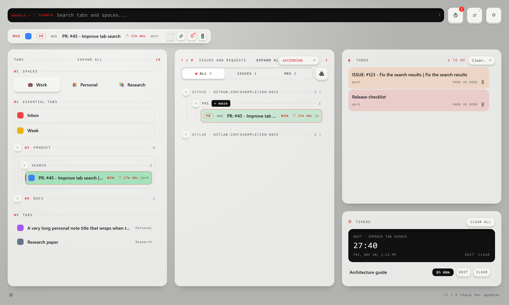
      </picture>
    </td>
    <td width="50%">
      <picture>
        <source media="(prefers-color-scheme: dark)" srcset="docs/screenshots/dark/tab-move-to-folder.png">
        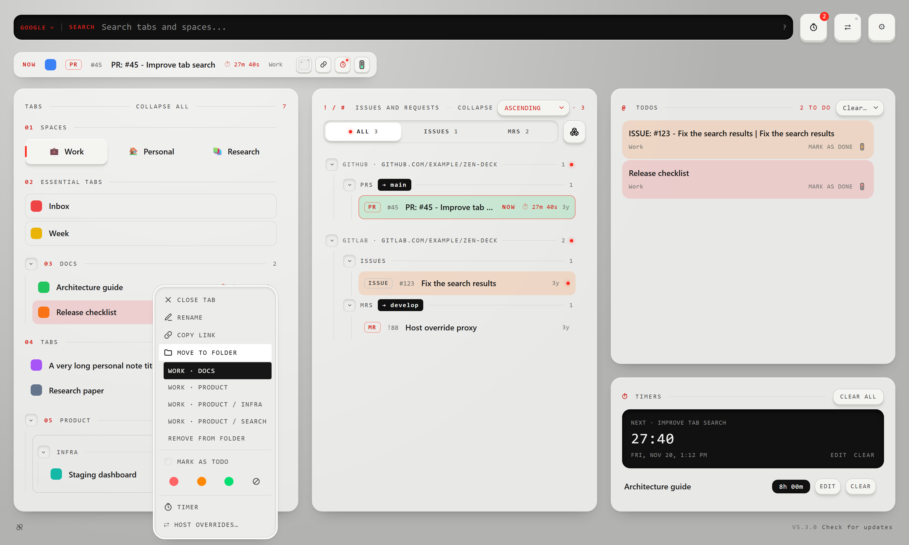
      </picture>
    </td>
  </tr>
</table>

### Toolbar popup (removed)

The toolbar popup has been removed. Its code remains in the repository but is inactive and can no longer be reached. Use the omnibar instead: `Alt+F` opens it, and on pages with no attachable DOM it is hosted in the browser chrome, so search still works there.

### Status, rename, and the tab menu

Right-click a tab to open its context menu. All of the extension's extra features are gathered there, and some of Zen's own browser features are built into it too:

- **Close tab**, **Rename**, and **Move to folder** or **Remove from folder**
- The pinned URL actions for pinned and essential tabs
- A status row
- **Mark as todo**, **Timer**, and **Host overrides**

The right-click opens this menu and nothing else, so Zen's own menu does not appear underneath it. `Alt+R` auto-labels GitLab and GitHub issues and MRs/PRs, or opens Zen's Change Label editor on other pages.

The status is a traffic light you set per tab: red, orange, and green dots, plus a forbidden sign for no status. It tints the tab's row in every column. The colours are blank canvas: what they mean is entirely up to you.

| Context menu | Status |
| :----------: | :----: |
| 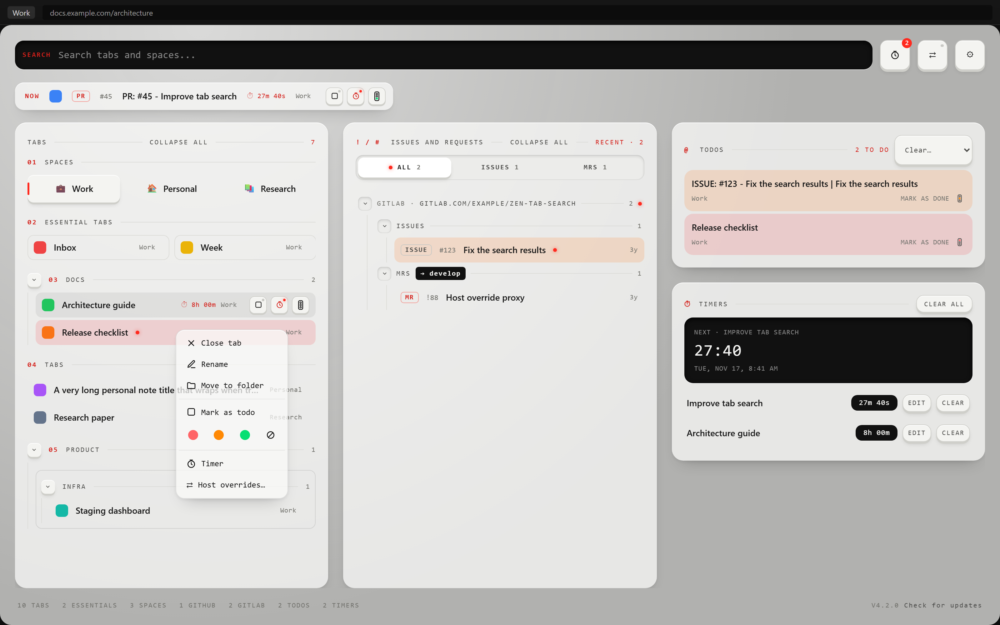 | 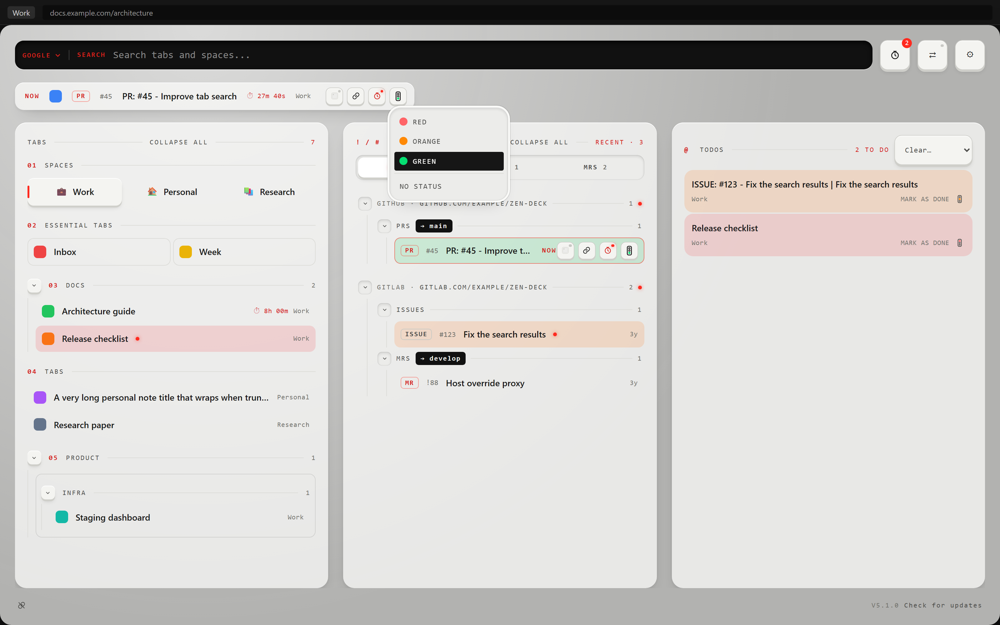 |

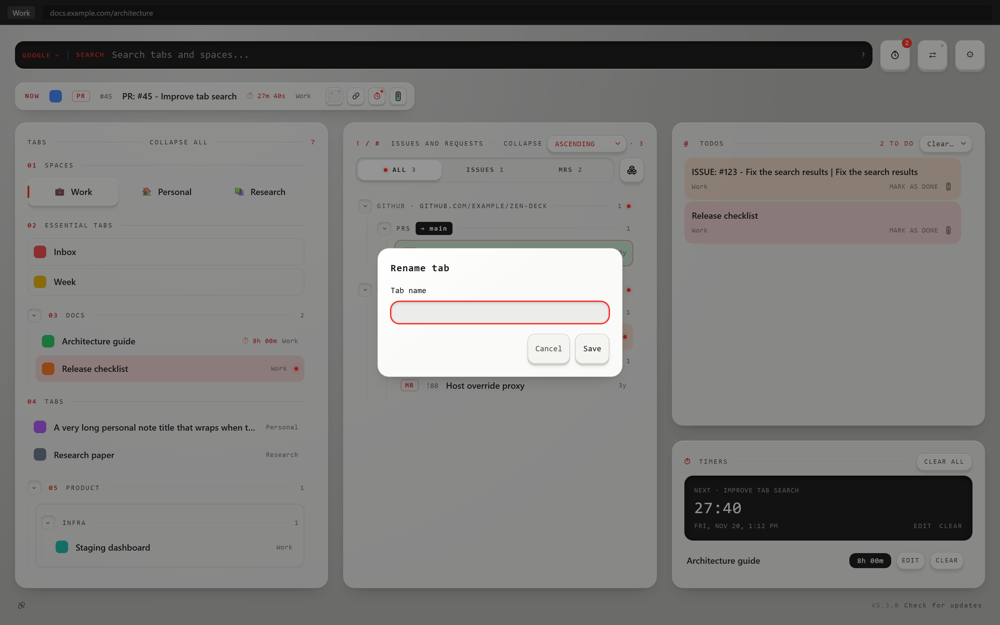

#### Renaming essential tabs

Zen does not offer a way to rename essential tabs, but Zen Tab Search does. Rename one from its tile and the extension keeps that name itself. It shows on the tile, and search matches it too, so `inbox` finds the essential you named Inbox even though its page is titled Mail. You can find an essential tab by its URL, by the page title from the browser, or by your custom name. The name lives only in the extension's views; Zen's own sidebar keeps the page title.

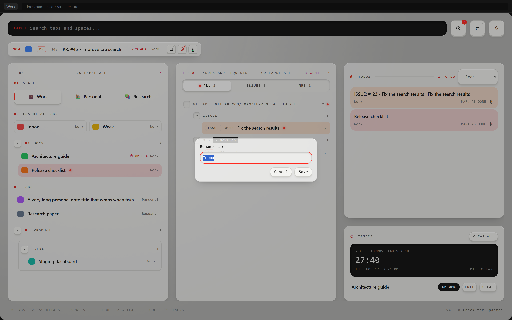

### Pinned URLs

A pinned tab and an essential tab each keep a stored address in Zen. Their context menu has two actions:

- **Edit pinned URL** opens a dialog with the address. Enter a web address and press **Save**. Anything else is refused with a message.
- **Replace pinned URL with current** stores the address the tab is showing now.

<p align="center">
  <picture>
    <source media="(prefers-color-scheme: dark)" srcset="docs/screenshots/dark/pinned-url.png">
    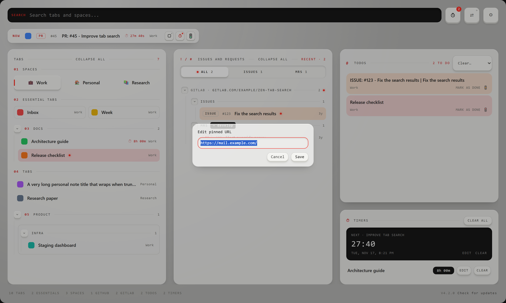
  </picture>
</p>

### Timers

`Alt+T` sets a timer on the current tab. The clock on a result and **Timer** in the tab menu open the same controls. Running timers show a countdown on the row. The timers dock sits at the bottom of the omnibar. It shows the soonest running timer as a large LCD readout, with quiet **Edit** and **Clear** on that readout, and up to two upcoming timers listed beneath it, each with **Edit** and **Clear** buttons. Countdowns that run longer than an hour read as days, hours and minutes. The to-dos column above it takes the remaining height and scrolls when it runs long.

The ⏱ button beside the search field, with a badge counting the running timers, opens the **Active timers** list with all of them. From there you can jump to a tab, edit a timer, or clear them all. While the list is open the button becomes ✕.

<p align="center">
  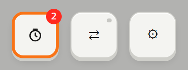
</p>

Timers survive a restart, including on tabs in a space you haven't opened yet. When one finishes you get a notification, and clicking it switches to the tab. If the tab was closed, the notice says so, and clicking it searches for the tab by name instead.

Besides the presets, the **When** field reads plain language. It has the keyboard as soon as the timer controls open; the search field stays inactive until you go back. Type a duration like `45m`, `2h`, or `1d 30m`, or a moment like `tomorrow at 9am`, `friday at 5pm`, or `next monday`. **Ends at** fills in as you type, so you can check the result before pressing **Set**, or pick the date and time there directly.

<p align="center">
  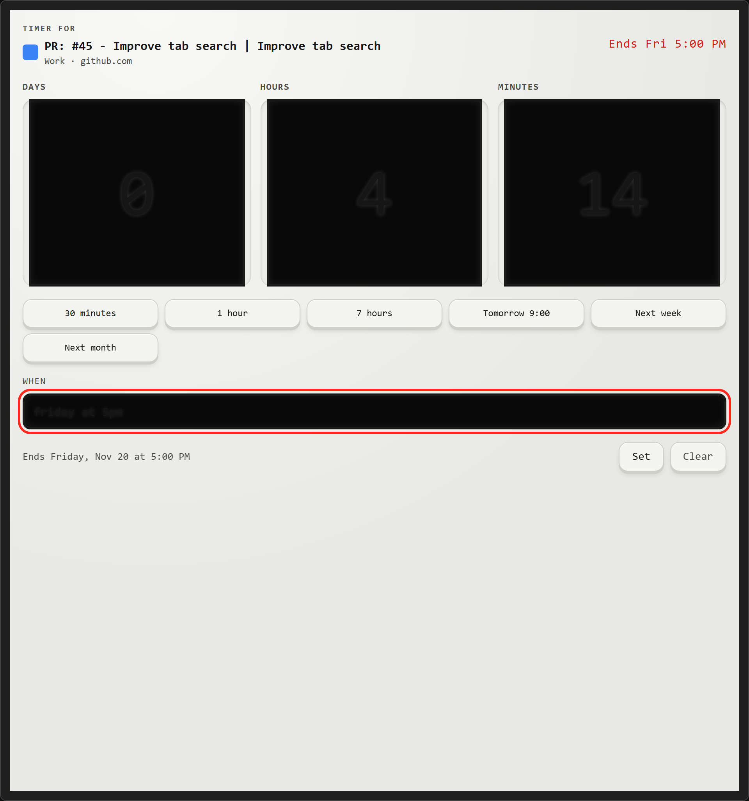
</p>

<table>
  <tr>
    <th width="50%">Active timers</th>
    <th width="50%">Create or edit a timer</th>
  </tr>
  <tr>
    <td width="50%">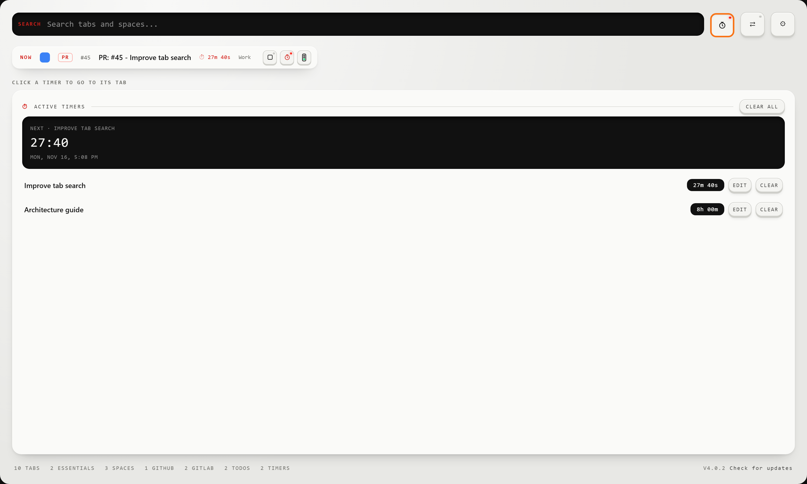</td>
    <td width="50%">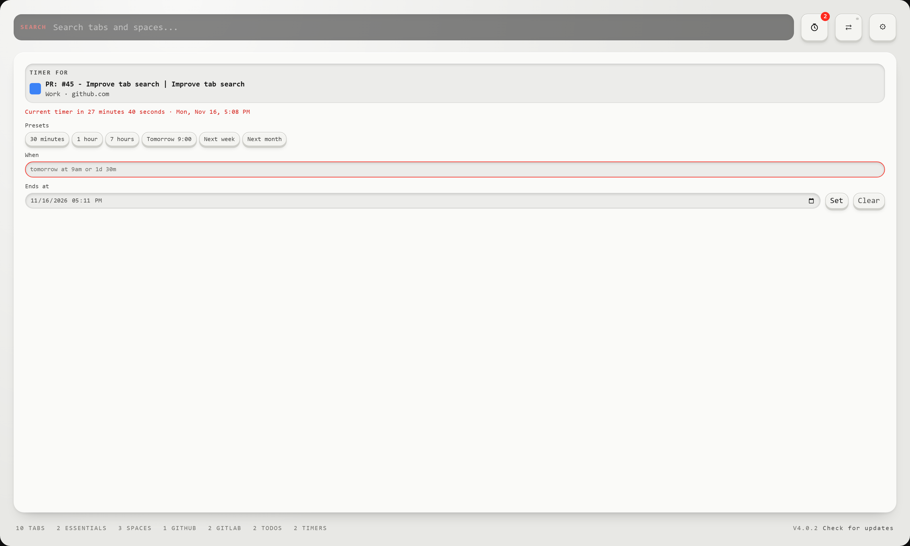</td>
  </tr>
</table>

### Host overrides

Pin a tab’s hostnames to a fixed IP, like a per-tab hosts file. Open the editor from the ⇄ button beside the search field, from **Host overrides** in a result's menu, or by right-clicking any page: Zen's own context menu has **Host overrides** → **Manage host overrides…**, plus **Turn all off** to switch off every override for that tab.

<p align="center">
  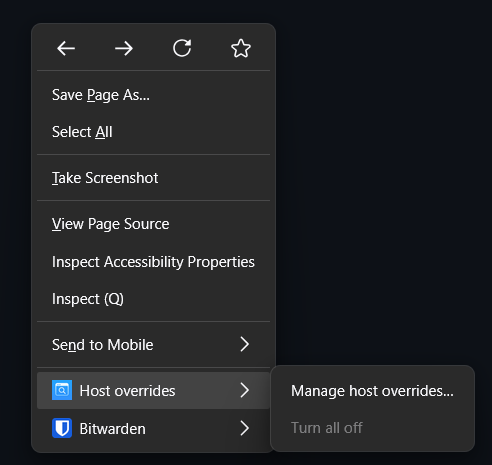
</p>

<p align="center">
  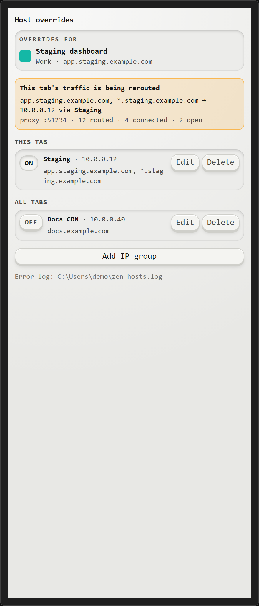
</p>

### Layout and theme

The **Theme** module picks **System**, **Light**, or **Dark**. System follows the browser's colour scheme. Accent, frame, panels, and text start on **AUTO**, which takes each colour from the theme, so light and dark keep a fitting palette until you pick your own.

**Background opacity** is a dial from 0% to 100%, in 5% steps, and it starts at 75%. It fades the panels so the page behind the omnibar shows through. Text, keys, and the timer readout stay solid. The options page is not affected.

The interface uses IBM Plex Mono and Inter, bundled with the extension, so the overlay looks the same on every machine.

<p align="center">
  <picture>
    <source media="(prefers-color-scheme: dark)" srcset="docs/screenshots/dark/background-opacity-settings.png">
    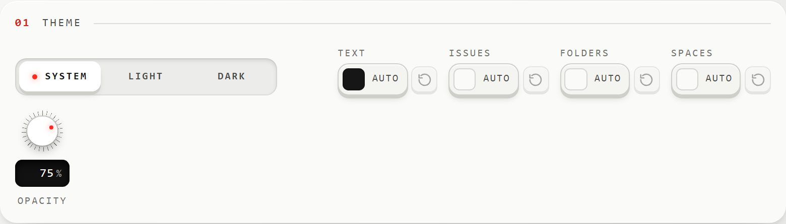
  </picture>
</p>

Hide the spaces grid, the essential-tabs grid, or both; hidden ones still turn up as soon as you search. **Truncate** shortens long tab and issue titles by default. Switch it off to wrap the full title onto several lines. Font size, density, and the gap sliders reshape the omnibar. On the omnibar, **Ctrl + mouse wheel** changes the font size one pixel per notch, the same as the Font size slider. Accent, frame, panels, and text each have their own reset.

The four colour keys start on AUTO. Light and dark each keep their own palette until you pick a colour:

<p align="center">
  <picture>
    <source media="(prefers-color-scheme: dark)" srcset="docs/screenshots/dark/theme-colors.png">
    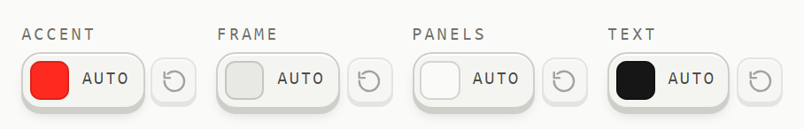
  </picture>
</p>

| Hidden grids | Wrapping titles |
| :----------: | :-------------: |
| 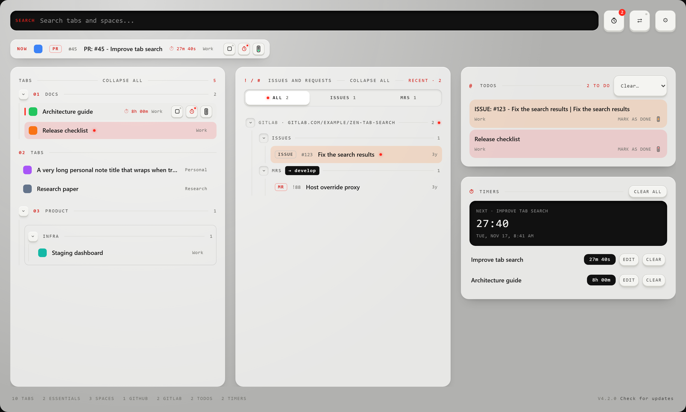 | 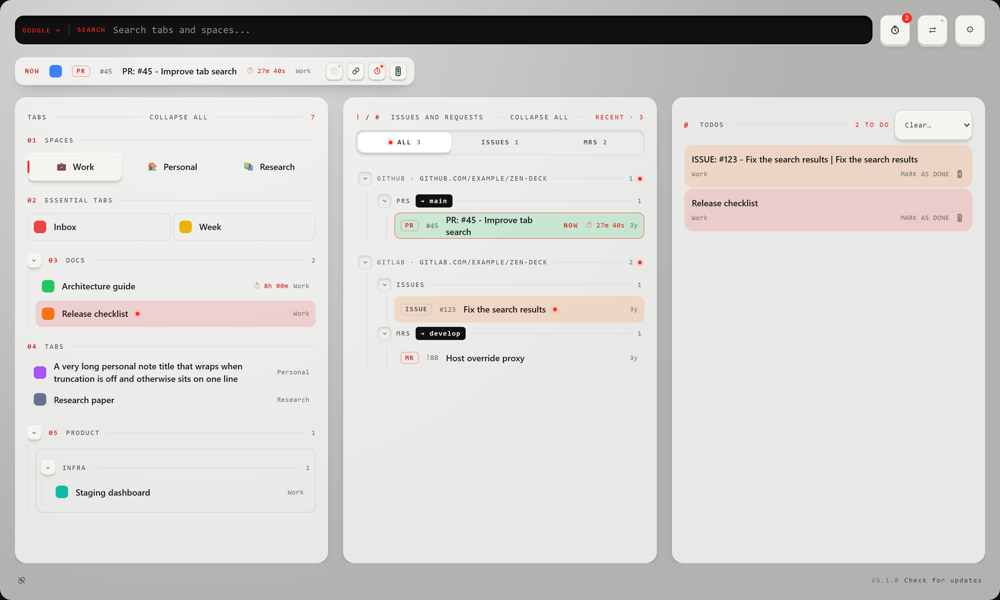 |

**Custom colors** tint the hardware tokens: the red accent, the chassis frame, the cards, and the ink. Pick a colour for each and the omnibar uses it in both light and dark. Each colour has a reset that returns it to AUTO. The example is a warm dark palette, bronze on brown, with the text left on AUTO.

| Color keys | On the omnibar |
| :--------: | :------------: |
| 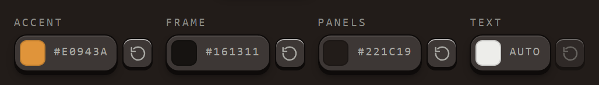 | 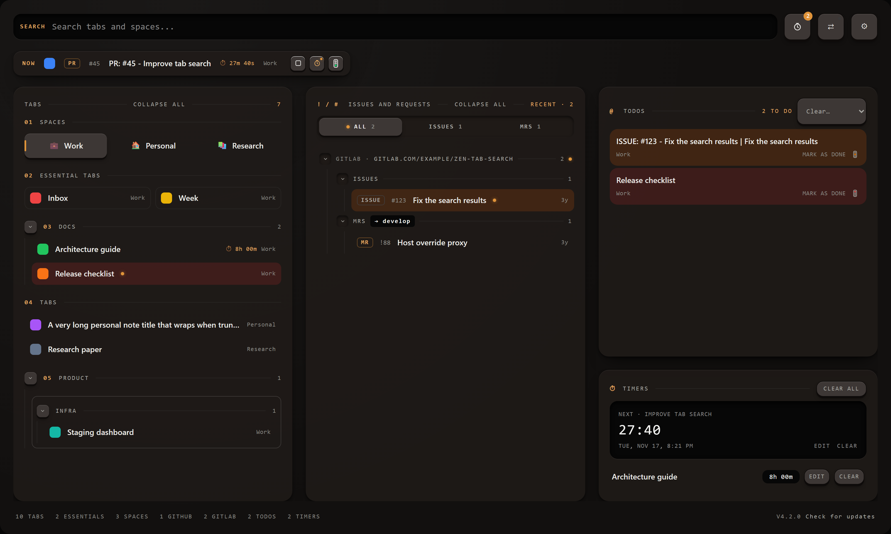 |

<p align="center">
  <picture>
    <source media="(prefers-color-scheme: dark)" srcset="docs/screenshots/dark/spacing-size-and-zoom.png">
    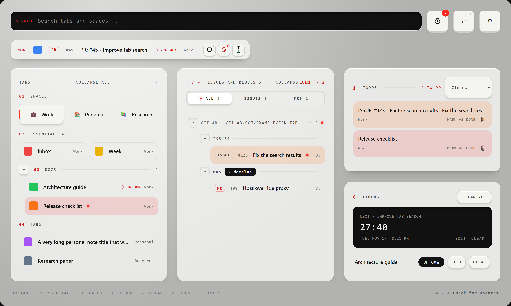
  </picture>
</p>

### Sound

**Interface sounds** are on by default. Key clicks, latches, and chimes play while you search, rename a tab, edit a pinned URL, set todos, and set timers. The **Volume** dial sets the level. The **Click**, **Tick**, and **Chime** buttons play each voice so you can hear it before you use it. The switch turns every sound off.

The sounds come from the hardware kit in [SPEC-01](https://github.com/shuding/spec-01). Click around the UI and listen to them: they are Shu Ding's work, and we cannot commend him enough. See [Special thanks](#special-thanks).

<p align="center">
  <picture>
    <source media="(prefers-color-scheme: dark)" srcset="docs/screenshots/dark/sound-settings.png">
    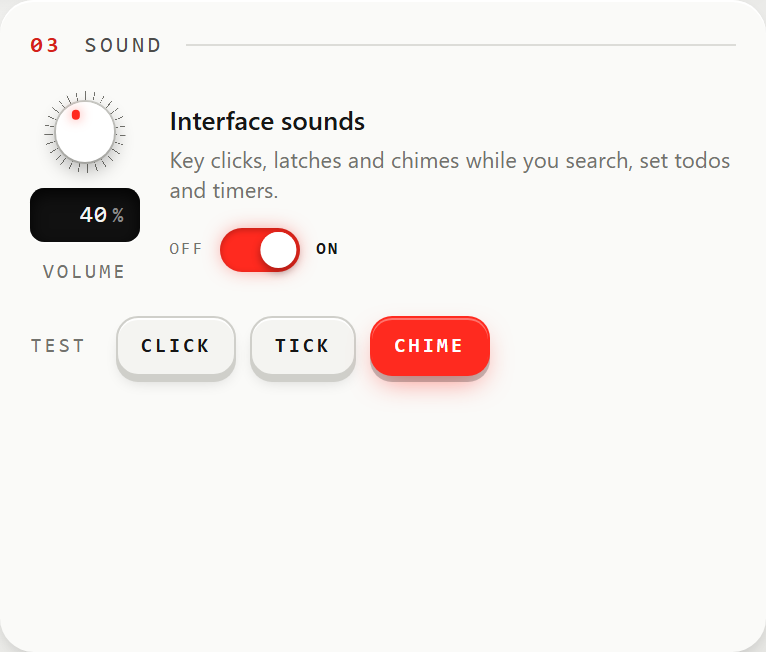
  </picture>
</p>

### Reuse an open tab for external links

When another app opens a link in Zen (a mail client, Slack, a terminal), Zen normally opens a new tab every time. Turn on **Reuse an open tab** under **External links** in Display options, and Zen switches to a tab that already has that address instead, across spaces, so the same page does not pile up in duplicates.

**For example:**

1. A developer messages you on Slack with a link to a merge request.
2. You already have that merge request open, either as a pinned tab or as an ordinary tab.
3. You click the link. Zen switches to your existing tab instead of opening a second copy.

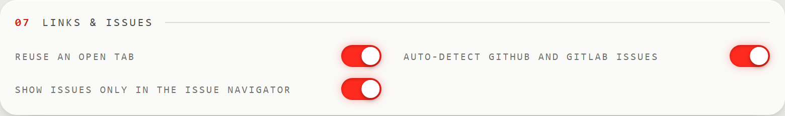

### AI agents (MCP)

Claude, Cursor, and other MCP clients can list spaces, folders, and tabs, rename tabs (essential tabs included), create and rename folders, move tabs, reorder them, and set tab colors. They can also read and set a pinned tab's stored URL, or replace it with the page the tab is showing now, and work with todos, timers, and GitHub and GitLab labels. Turn the bridge on in Display options, then follow [mcp/README.md](mcp/README.md). It only listens on this computer and only accepts the token from your settings. For an agent on another machine, see [Remote agents over SSH](mcp/README.md#remote-agents-over-ssh).

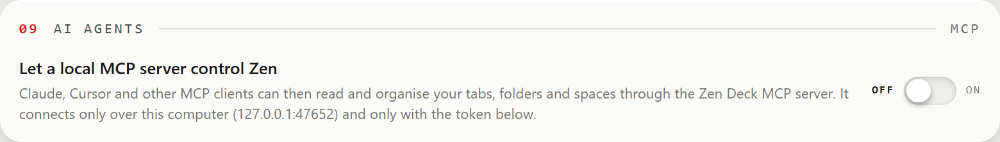

## Important notices

- This extension is exclusive to Zen Browser and relies on Zen's internal workspace and tab APIs.
- It uses privileged `experiment_apis`, so it cannot be published on addons.mozilla.org (AMO) and must be installed from a zip file.
- `extensions.experiments.enabled` must be `true` for Zen's extension APIs to be available.
- `xpinstall.signatures.required` must be `false` to install the unsigned zip.

## Credits and license

This project is based on [https://github.com/AntonDobrovinskiy/Zen-Tab-Search](https://github.com/AntonDobrovinskiy/Zen-Tab-Search), which is released under the MIT license. Anton Dobrovinskiy retains the copyright as per the MIT license.

This repository is a fork of that project with rewritten git history.

See [LICENSE](LICENSE) for the full MIT license text.

### Special thanks

A huge thank you to **Shu Ding** ([@shuding](https://github.com/shuding)), who created [SPEC-01](https://github.com/shuding/spec-01), the hardware-style UI kit behind this extension's look and interface sounds ([live demo](https://spec-01.vercel.app)). His development made the extension look significantly better and feel much more satisfying to use. The key clicks, latches, and chimes you hear are his design. We cannot thank him enough.

## Why this cannot be published on AMO

Mozilla intentionally blocks extensions that declare `experiment_apis` (privileged Experiment APIs) from being submitted to addons.mozilla.org, so this repository does not maintain an AMO signing flow. End users still need `extensions.experiments.enabled` set to `true` for the Zen-specific APIs (`browser.zenTabs`) to be available, and `xpinstall.signatures.required` set to `false` to install the unsigned zip.

The only supported distribution method for this extension is sideloading a zip (or XPI) as described above.

## Creating a release

Releases are published as GitHub release zips. The release script bumps the package version, commits the version files, tags the commit, builds the extension zip and the MCP server bundle, creates a GitHub release, and attaches both.

```bash
npm run release -- patch --message "Maintenance release"
npm run release -- minor --notes-file ./RELEASE.md
npm run release -- patch --generate-notes
npm run release -- major --canary --notes-file ./RELEASE.md
npm run release -- patch --dry-run --generate-notes
```

Use `patch`/`bump`, `minor`, `major`, or an exact `x.y.z` version. Release notes can be supplied with `--message`, loaded with `--notes-file`, or generated from commits since the latest tag with `--generate-notes`. Add `--canary` to publish that tag as a GitHub prerelease, so it is not marked Latest. The script requires a clean working tree and an authenticated GitHub CLI session (`gh auth login`) before it starts.

Release checklist:

1. Start from `main` with `git status` clean.
2. Confirm GitHub CLI auth with `gh auth status`.
3. Preview the release with `npm run release -- patch --dry-run --generate-notes`.
4. Run the release command, for example `npm run release -- patch --generate-notes`.
5. Confirm the GitHub release contains both assets: `zen-tab-search-<version>-firefox.zip` and `zen-tab-search-mcp.mjs`.

If a release fails, follow the recovery instructions printed by the script before retrying.

## Development

**Using Cursor?** Run the `[/quick-start](.cursor/commands/quick-start.md)` command.

Otherwise:

```bash
npm install
npm run dev
```

While the dev server is running, WXT rebuilds and reloads the extension on file changes.

README stills come from a mocked UI harness, not from Zen itself. Generate them with:

```bash
npm run screenshots
```

That writes PNGs to `docs/screenshots/`, and the dark-theme captures to `docs/screenshots/dark/`. The README shows the dark captures to readers who use a dark colour scheme. `npm run screenshots:dev` serves the harness at `http://127.0.0.1:4177/screenshots/index.html?scene=search-omnibar` so you can inspect a scene before capturing it.

Load in Zen Browser:

1. Open `about:debugging`
2. Click **This Firefox**
3. **Load Temporary Add-on…**
4. Select `manifest.json` from `.output/firefox-mv2/`

Run quality checks:

```bash
npm run lint:js
npm run format
npm test
npm run lint:web-ext
```

Pre-commit hooks run through Husky and lint-staged. They format staged JSON, Markdown, and CSS files, run ESLint fixes for staged JavaScript/TypeScript files, and run the `web-ext` lint wrapper when extension files change. The wrapper allows the known privileged `experiment_apis` finding because this project is distributed as a sideload-only Zen Browser zip.

## Project structure

```
entrypoints/          WXT entry points (background, content script, options)
app/                  Background wiring that spans features
features/             search, timers, todos, status, forge, settings, zen, bridge, hosts, intercept, updates
shared/               Wire protocol, types, logging, styles
mcp/                  MCP server that lets AI agents drive Zen through the extension
public/experiment/    Privileged Experiment API (zenTabs) — required for cross-space Zen support
public/icon/          Extension icons
scripts/              Build and release helpers
docs/screenshots/     Feature stills used above, generated by `npm run screenshots`
screenshots/          Mocked UI harness that Playwright captures from
```

## License

MIT — see [LICENSE](LICENSE). The original author (Anton Dobrovinskiy) retains copyright as per the MIT terms.
