# Zen Tab Search Anytime and Anywhere

Find any tab, switch spaces, add context, and stay focused in Zen Browser.

Zen Tab Search is a fast fuzzy search overlay and popup for tabs, spaces, and custom labels. It is exclusive to [Zen Browser](https://zen-browser.app/).

## Features

Open **Display options** from the gear on either search surface. Change or assign shortcuts in `about:addons` → **Zen Tab Search** → **Manage Extension Shortcuts**.

### Omnibar

`Alt+F` opens the omnibar. On a page the extension can attach to it draws over that tab; otherwise it hosts the same UI in the browser chrome, so search still works with no content tab and no page DOM. It searches titles, URLs, and custom labels across every Zen space. Spaces and essential tabs sit in grids above the list; Zen folders become their own sections. GitHub and GitLab issues open in a navigator beside the tabs, and tabs you marked as todo sit in a third column. `Up` / `Down` move one result, `Left` / `Right` jump several, `Enter` activates, `Escape` closes. `Tab` moves between the tab list and the issue navigator; a query that starts with `#` or `!` jumps straight to issues.

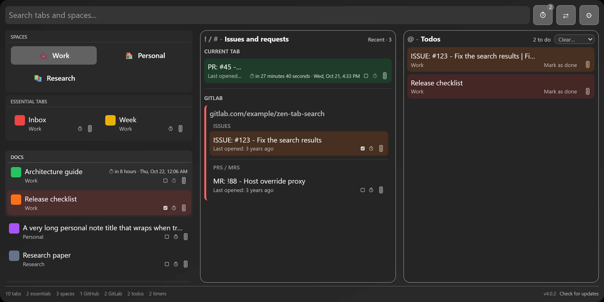

Type to filter. With **Show issues only in the issue navigator** on, issue and MR/PR tabs stay in the middle column and drop out of the tab list.

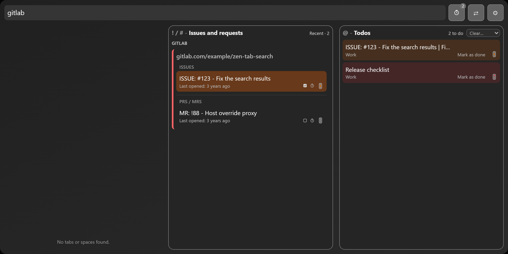

### Toolbar popup

The toolbar popup is a compact legacy surface. `Alt+F` no longer opens it; the window-hosted omnibar covers pages with no attachable DOM. It stays fully functional. **Open Zen Tab Search popup** toggles it and ships with no key; assign one in `about:addons` → **Manage Extension Shortcuts**.

<p align="center">
  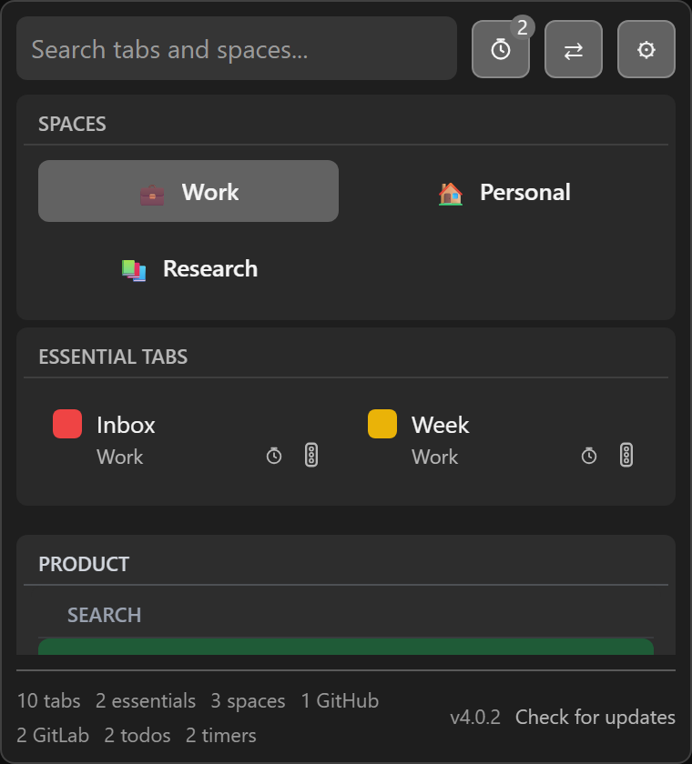
</p>

### Status, rename, and the tab menu

Right-click a result for rename, timer, host overrides, todo, and a red / orange / green status. `Alt+R` auto-labels GitLab and GitHub issues and MRs/PRs, or opens Zen's Change Label editor on other pages.

| Context menu | Status |
| :----------: | :----: |
| 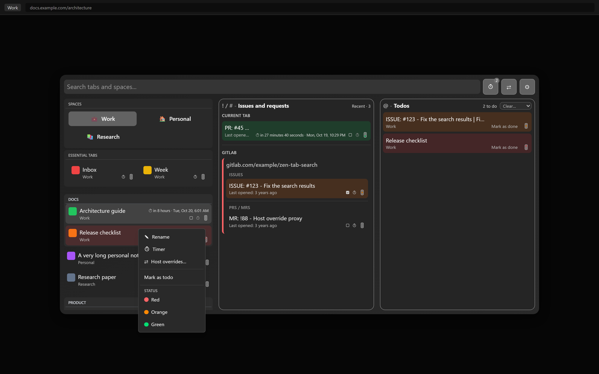 | 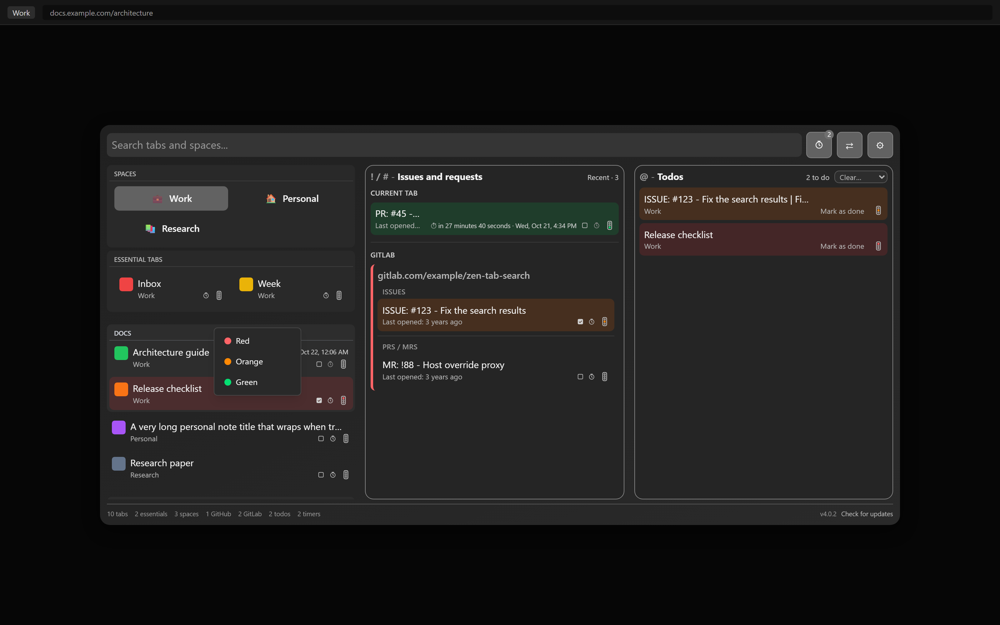 |

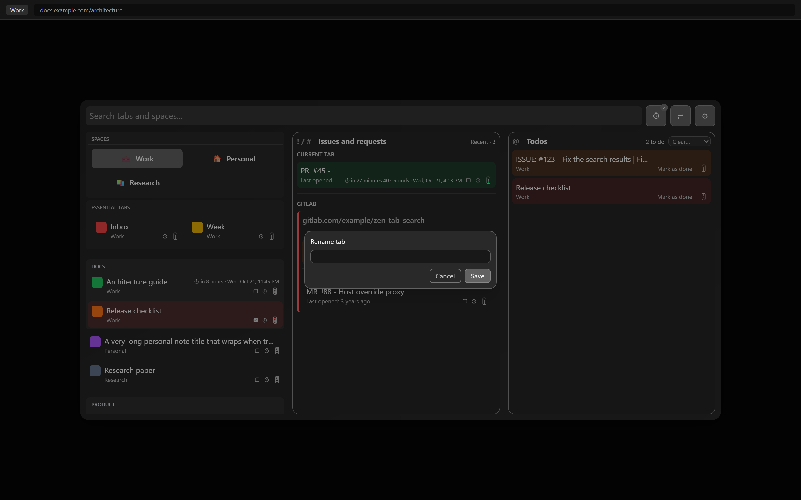

### Timers

`Alt+T` sets a timer on the current tab. The clock on a result, **Timer** in the tab menu, and the clock beside the search field open the same controls. Running timers show a countdown on the row; the list lets you jump to a tab, edit one, or clear them all.

| Active timers | Set a timer |
| :-----------: | :---------: |
| 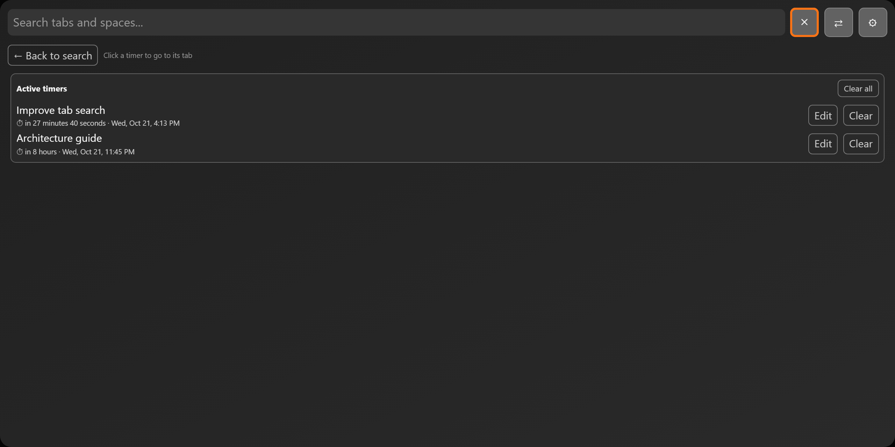 | 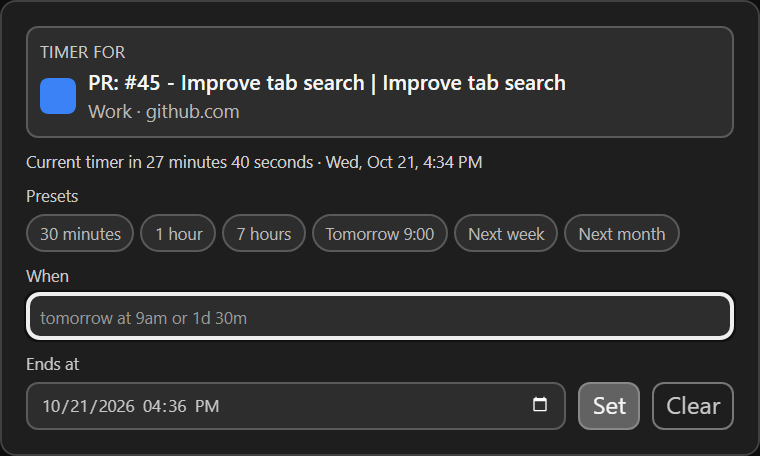 |

### Host overrides

Pin a tab’s hostnames to a fixed IP, like a per-tab hosts file. The overlay and the result menu both open the editor.

<p align="center">
  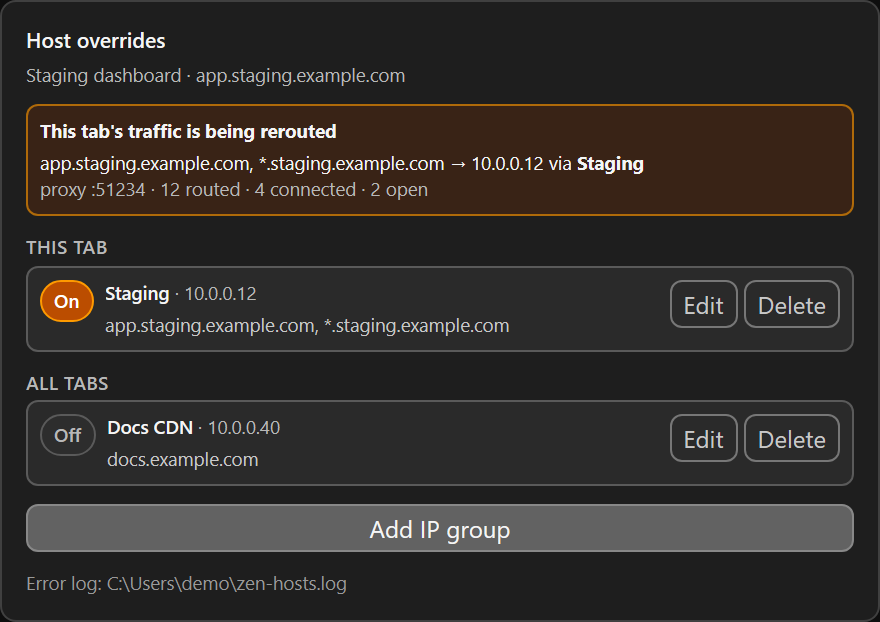
</p>

### Layout and theme

Hide the spaces grid, the essential-tabs grid, or both, independently on the omnibar and the toolbar popup. Turn wrapping on when you want the full title. Font size, density, and the gap sliders reshape the omnibar; the popup stays a compact fixed size. Text, issue, folder, and space colors each have their own reset.

| Hidden grids | Wrapping titles |
| :----------: | :-------------: |
| 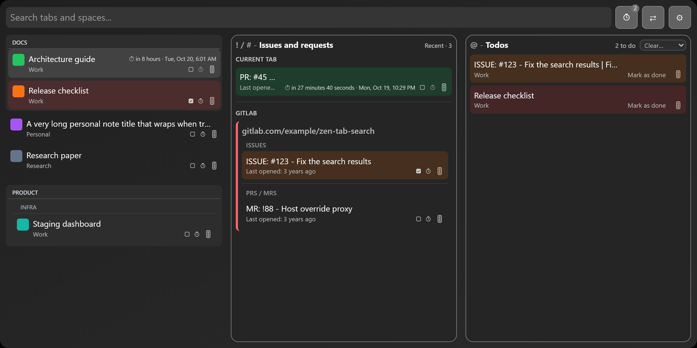 | 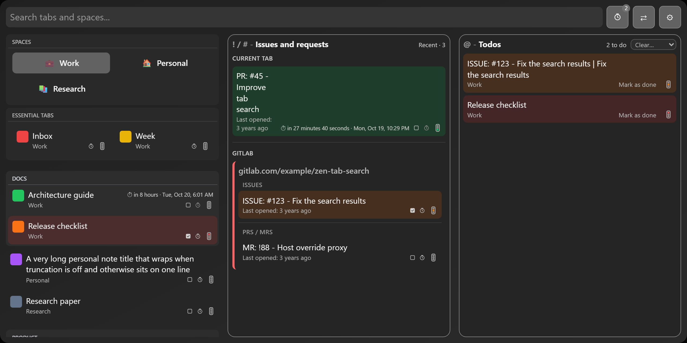 |

| Larger type and density | Custom colors |
| :---------------------: | :-----------: |
| 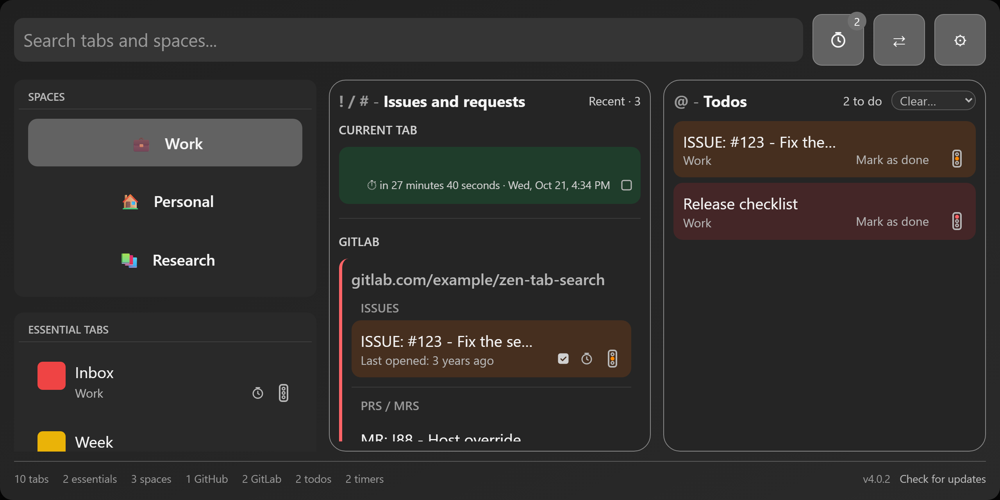 | 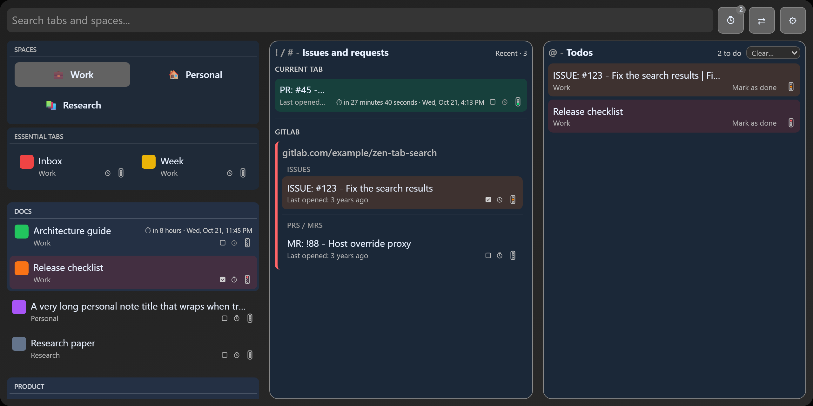 |

**Reuse an open tab**, under External links, focuses a tab that already has an address when another app opens that link in Zen.

### AI agents (MCP)

Claude, Cursor, and other MCP clients can list spaces, folders, and tabs, rename tabs, create and rename folders, move tabs, reorder them, and set tab colors. Turn the bridge on in Display options, then follow [mcp/README.md](mcp/README.md). It only listens on this computer and only accepts the token from your settings. For an agent on another machine, see [Remote agents over SSH](mcp/README.md#remote-agents-over-ssh).

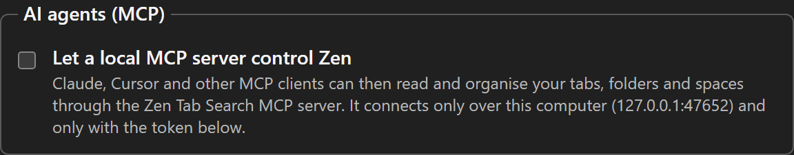


## Installation


### From a GitHub release (recommended)

1. Download the latest `.zip` from the [Releases page](https://github.com/SanderCokart/Zen-Tab-Search-Anytime-and-Anywhere/releases).
2. Open `about:config` in Zen Browser.
3. Set these preferences and restart Zen:
  - `extensions.experiments.enabled` = `true`
  - `xpinstall.signatures.required` = `false`
4. Open `about:addons`, click the gear icon, and choose **Install Add-on From File…**.
5. Select the downloaded `.zip` (you can also drag it onto the page).

**Optional: let AI agents control Zen.** The same release has a `zen-tab-search-mcp.mjs` asset, the MCP server for Claude, Cursor and other MCP clients. It needs Node.js 20 or newer. See [mcp/README.md](mcp/README.md#install) to download it, turn it on in the settings, and register it with your client.


### Build from source

```bash
npm install
npm run zip
```

The zip will be produced by WXT. Install it using the same `about:addons` → gear → **Install Add-on From File…** flow above.

## At a glance

- Omnibar search with `Alt+F`, including when no page DOM is available
- A legacy toolbar popup that stays fully functional, with an unmapped shortcut
- GitHub and GitLab issues in a navigator beside the tabs
- Todos, traffic-light status, and rename from the result menu
- Folder and subfolder sections
- Timers from search, the tab menu, or `Alt+T`
- Per-tab host overrides
- Hide essentials or spaces, wrap or truncate titles, and theme the omnibar
- Reuse of an already open tab for external links
- Optional local MCP server for AI agents


## Important notices

- This extension is exclusive to Zen Browser and relies on Zen's internal workspace and tab APIs.
- It uses privileged `experiment_apis`, so it cannot be published on addons.mozilla.org (AMO) and must be installed from a zip file.
- `extensions.experiments.enabled` must be `true` for Zen's extension APIs to be available.
- `xpinstall.signatures.required` must be `false` to install the unsigned zip.


## Credits and license

This project is based on [https://github.com/AntonDobrovinskiy/Zen-Tab-Search](https://github.com/AntonDobrovinskiy/Zen-Tab-Search), which is released under the MIT license. Anton Dobrovinskiy retains the copyright as per the MIT license.

This repository is a fork of that project with rewritten git history.

See [LICENSE](LICENSE) for the full MIT license text.

## Why this cannot be published on AMO

Mozilla intentionally blocks extensions that declare `experiment_apis` (privileged Experiment APIs) from being submitted to addons.mozilla.org, so this repository does not maintain an AMO signing flow. End users still need `extensions.experiments.enabled` set to `true` for the Zen-specific APIs (`browser.zenTabs`) to be available, and `xpinstall.signatures.required` set to `false` to install the unsigned zip.

The only supported distribution method for this extension is sideloading a zip (or XPI) as described above.

## Creating a release

Releases are published as GitHub release zips. The release script bumps the package version, commits the version files, tags the commit, builds the extension zip and the MCP server bundle, creates a GitHub release, and attaches both.

```bash
npm run release -- patch --message "Maintenance release"
npm run release -- minor --notes-file ./RELEASE.md
npm run release -- patch --generate-notes
npm run release -- major --canary --notes-file ./RELEASE.md
npm run release -- patch --dry-run --generate-notes
```

Use `patch`/`bump`, `minor`, `major`, or an exact `x.y.z` version. Release notes can be supplied with `--message`, loaded with `--notes-file`, or generated from commits since the latest tag with `--generate-notes`. Add `--canary` to publish that tag as a GitHub prerelease, so it is not marked Latest. The script requires a clean working tree and an authenticated GitHub CLI session (`gh auth login`) before it starts.

Release checklist:

1. Start from `main` with `git status` clean.
2. Confirm GitHub CLI auth with `gh auth status`.
3. Preview the release with `npm run release -- patch --dry-run --generate-notes`.
4. Run the release command, for example `npm run release -- patch --generate-notes`.
5. Confirm the GitHub release contains both assets: `zen-tab-search-<version>-firefox.zip` and `zen-tab-search-mcp.mjs`.

If a release fails, follow the recovery instructions printed by the script before retrying.

## Development

**Using Cursor?** Run the `[/quick-start](.cursor/commands/quick-start.md)` command.

Otherwise:

```bash
npm install
npm run dev
```

While the dev server is running, WXT rebuilds and reloads the extension on file changes.

README stills come from a mocked UI harness, not from Zen itself. Generate them with:

```bash
npm run screenshots
```

That writes PNGs to `docs/screenshots/`. `npm run screenshots:dev` serves the harness at `http://127.0.0.1:4177/screenshots/index.html?scene=search-omnibar` so you can inspect a scene before capturing it.

Load in Zen Browser:

1. Open `about:debugging`
2. Click **This Firefox**
3. **Load Temporary Add-on…**
4. Select `manifest.json` from `.output/firefox-mv2/`

Run quality checks:

```bash
npm run lint:js
npm run format
npm test
npm run lint:web-ext
```

Pre-commit hooks run through Husky and lint-staged. They format staged JSON, Markdown, and CSS files, run ESLint fixes for staged JavaScript/TypeScript files, and run the `web-ext` lint wrapper when extension files change. The wrapper allows the known privileged `experiment_apis` finding because this project is distributed as a sideload-only Zen Browser zip.

## Project structure

```
entrypoints/          WXT entry points (background, content script, popup, options)
app/                  Background wiring that spans features
features/             search, timers, forge, settings, zen, bridge
shared/               Wire protocol, types, logging, styles
mcp/                  MCP server that lets AI agents drive Zen through the extension
public/experiment/    Privileged Experiment API (zenTabs) — required for cross-space Zen support
public/icon/          Extension icons
scripts/              Build and release helpers
docs/screenshots/     Feature stills used above, generated by `npm run screenshots`
screenshots/          Mocked UI harness that Playwright captures from
```


## License

MIT — see [LICENSE](LICENSE). The original author (Anton Dobrovinskiy) retains copyright as per the MIT terms.